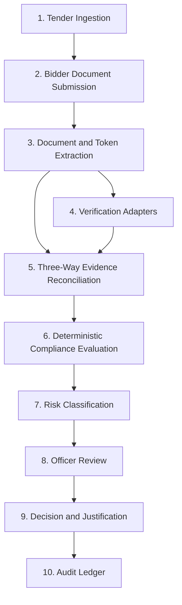
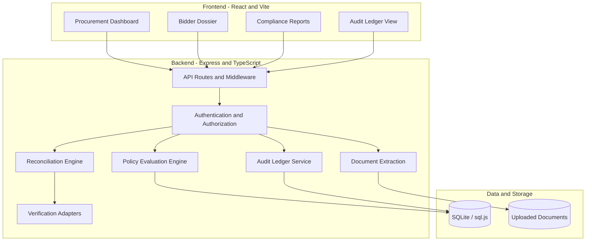

# TENDER GUARD AI

### Truth • Transparency • Trust in Public Procurement

**Tender Guard AI** is an evidence-driven, policy-as-code bid compliance verification and decision-support platform designed for the Government e-Marketplace (GeM) ecosystem under General Financial Rules (GFR 2017) Rule 144.

The platform helps procurement teams analyze tender requirements, examine bidder documents, identify compliance gaps, reconcile conflicting evidence, and generate traceable compliance reports. It combines AI-assisted document extraction with deterministic policy evaluation and human oversight.

[](https://github.com/sumitk-lab/TENDER-GUARD-AI)
[](https://www.typescriptlang.org/)
[](./Dockerfile)
[](./LICENSE)

---

## Table of Contents

- [Project Overview](#project-overview)
- [Problem Statement](#problem-statement)
- [Our Solution](#our-solution)
- [Key Features](#key-features)
- [Three-Way Evidence Reconciliation](#three-way-evidence-reconciliation)
- [End-to-End Workflow](#end-to-end-workflow)
- [Compliance Scoring and Risk Classification](#compliance-scoring-and-risk-classification)
- [AI Architecture and Governance](#ai-architecture-and-governance)
- [Verification Adapters](#verification-adapters)
- [Evidence Provenance](#evidence-provenance)
- [Tamper-Evident Audit Ledger](#tamper-evident-audit-ledger)
- [Security](#security)
- [Technology Stack](#technology-stack)
- [System Architecture](#system-architecture)
- [Repository Structure](#repository-structure)
- [Installation and Local Setup](#installation-and-local-setup)
- [Environment Configuration](#environment-configuration)
- [Running the Application](#running-the-application)
- [API Health Check](#api-health-check)
- [Testing and Type Checking](#testing-and-type-checking)
- [Docker Deployment](#docker-deployment)
- [Cloud Deployment](#cloud-deployment)
- [Limitations and Disclosures](#limitations-and-disclosures)
- [Future Enhancements](#future-enhancements)
- [Contributing](#contributing)
- [License](#license)

---

## Project Overview

Government procurement involves evaluating large volumes of documents against tender-specific eligibility conditions, financial requirements, statutory registrations, and technical specifications.

Tender Guard AI is designed to assist procurement officers by bringing these checks into a unified digital workflow.

Instead of relying exclusively on manual document inspection, the platform organizes evidence, applies defined compliance rules, highlights inconsistencies, and provides an auditable basis for human review.

### Project Objectives

- Reduce repetitive manual compliance checks.
- Identify missing, inconsistent, or potentially invalid bidder information.
- Compare tender requirements with submitted documentary evidence.
- Support consistent application of procurement policies.
- Improve traceability through evidence-linked findings and audit records.
- Help procurement officers make informed decisions without replacing their statutory authority.

### Intended Users

- Procurement officers and tender evaluation committees.
- Government purchasing departments.
- Compliance and contract-management teams.
- Organizations participating in public procurement.
- Developers building procurement automation and compliance systems.

---

## Problem Statement

**Smart India Hackathon 2026 — Problem Statement SIH26100**

*AI-Powered Integrated Bid Compliance Verification Platform for GeM Procurement.*

In public procurement workflows involving the Government e-Marketplace (GeM) and Central Public Procurement Portal (CPPP), tender evaluation committees may need to inspect extensive technical and financial documentation within strict deadlines.

Examples of checks include:

- GST registration and taxpayer details.
- PAN and legal-entity consistency.
- Udyam MSME registration and applicable exemptions.
- Make in India local-content declarations.
- Original Equipment Manufacturer (OEM) authorization.
- Employee-related statutory registrations, where applicable.
- Corporate registration and business status.
- Debarment and blacklisting concerns.

### Challenges with Manual Evaluation

**1. Prolonged tender evaluation**

Reviewing many documents and cross-checking information across different sources can increase evaluation time.

**2. Human error**

Expired documents, missing certificates, and inconsistent identifiers may be overlooked during repetitive manual checks.

**3. Cross-document contradictions**

The same business identifier or legal name may appear differently across registration documents, declarations, and financial records.

**4. Difficult evidence traceability**

A reviewer may need to locate the exact document, page, and statement supporting a particular compliance finding.

**5. Potential debarment evasion**

Entities using altered trade names or related business identities may require additional scrutiny during procurement checks.

Tender Guard AI is designed to address these challenges through structured evidence extraction, rule-based evaluation, and transparent review workflows.

---

## Our Solution

Tender Guard AI combines three major capabilities:

1. **AI-assisted document processing** to extract candidate information from tender and bidder documents.
2. **Deterministic policy-as-code evaluation** to apply explicit compliance rules and scoring logic.
3. **Evidence reconciliation and auditability** to document discrepancies and preserve a traceable history of system actions.

The intended output includes compliance findings, a normalized score where supported by the configured rules, a risk classification, and evidence that helps reviewers understand each result.

The platform is designed as a decision-support system. Final procurement decisions remain the responsibility of authorized human officers.

---

## Key Features

### 1. Tender Requirement Analysis

Organizes tender eligibility conditions, mandatory documents, financial thresholds, and technical requirements into structured checks.

### 2. Multi-Document Evidence Extraction

Processes supported document formats to identify relevant text, identifiers, certificate information, and declared values.

AI-assisted extraction may use a configured Google Gemini integration, with a deterministic fallback where implemented.

### 3. Three-Way Evidence Reconciliation

Compares tender requirements, bidder submissions, and independent or configured verification data to highlight agreements and discrepancies.

### 4. Policy-Based Compliance Scoring

Applies configured rules and weights to generate a compliance score. Mandatory conditions and statutory exemptions can receive special treatment according to the implemented policy.

### 5. Risk Classification

Supports the following risk categories where configured:

- `LOW`
- `MEDIUM`
- `HIGH`
- `CRITICAL`

### 6. Verification Adapters

Organizes checks for statutory registrations, business identity, eligibility declarations, and other procurement-related information.

**Important:** Adapters operating in demonstration mode do not constitute live verification by the corresponding government authority.

### 7. Evidence Provenance

Links compliance findings to source documents, extracted text, page references, and associated metadata where available.

### 8. Audit Logging

Records important state-changing operations and supports integrity verification through a SHA-256 hash-chained audit ledger.

### 9. Officer Review

Supports human review of evidence, findings, and compliance reports before a final procurement decision.

### 10. Compliance Reporting

Provides a structured view of findings intended to help reviewers understand why a requirement passed, failed, or needs further investigation.

---

## Three-Way Evidence Reconciliation

The core concept behind Tender Guard AI is **Three-Way Evidence Reconciliation**.

A compliance determination should not depend on a bidder's declaration alone. It should consider the applicable tender requirement, the evidence submitted, and any independent verification data that is available.

The three evidence planes are:

**1. Requirement Plane**

The applicable tender clause, eligibility condition, financial threshold, or local-content requirement.

**2. Bidder Evidence Plane**

The bidder's documents, extracted identifiers, declarations, certificate details, and supporting statements.

**3. Verification Plane**

Data from an independent registry or authorized verification source, when available. In demonstration mode, this plane may contain simulated data.

### Example: Make in India Local Content

Suppose a hypothetical tender requires at least 50% local content for a particular supplier classification.

A bidder declares 42% local content.

| Evidence | Example value |
|---|---|
| Tender requirement | Minimum 50% |
| Bidder declaration | 42% |
| Verification result | Requires independent confirmation |
| Preliminary finding | Below declared threshold |
| Suggested action | Flag for officer review |

The difference between the required threshold and the bidder's declaration is identifiable without AI making the final legal decision.

The configured rules can flag the discrepancy, explain the relevant condition, and preserve supporting evidence.

Actual eligibility consequences depend on the tender terms, applicable policy, and verified facts.

---

## End-to-End Workflow

The intended processing workflow is:



### Workflow Explanation

1. **Tender ingestion:** The system receives tender information and applicable requirements.
2. **Bidder submission:** Relevant bidder documents are uploaded for analysis.
3. **Extraction:** Supported files are processed to identify evidence and important fields.
4. **Verification:** Configured adapters evaluate relevant registration or eligibility information.
5. **Reconciliation:** The extracted evidence is compared against the requirements and verification results.
6. **Compliance evaluation:** The rules engine evaluates applicable checks.
7. **Risk classification:** Findings are organized into configured risk categories.
8. **Officer review:** An authorized reviewer examines the findings and supporting evidence.
9. **Decision:** The authorized officer records the decision and required justification.
10. **Audit:** The system records applicable actions in its audit trail.

The exact behavior of each step depends on the code, configured integrations, and available data.

---

## Compliance Scoring and Risk Classification

Tender Guard AI is designed to use explicit, reproducible rules rather than relying exclusively on an opaque AI-generated score.

A weighted compliance score can be expressed as:

\[
\text{Score} =
\frac{\text{Earned Applicable Weights}}
{\text{Total Applicable Weights}}
\times 100
\]

For example, if a bidder earns 72 out of 90 applicable weighted points:

\[
\text{Score} = \frac{72}{90}\times100 = 80
\]

The resulting score is 80 out of 100.

### Mandatory Requirements

Some conditions may be mandatory and cannot be treated like ordinary weighted checks. Depending on the configured policy, a missing mandatory document or failed eligibility condition may cap the score, trigger a finding, or require escalation.

### Statutory Exemptions

Where the applicable tender and law permit exemptions, the system should evaluate whether a bidder qualifies rather than automatically penalizing the bidder for an exempted condition.

### Risk Classification

Risk categories help prioritize review, but the thresholds and consequences must be defined by the implemented rules and applicable procurement policy.

A risk label or numeric score alone does not establish fraud, legal ineligibility, or grounds for disqualification.

---

## AI Architecture and Governance

Tender Guard AI separates AI-assisted extraction from deterministic compliance evaluation and authorized human decision-making.

```text
+---------------------------------------------------+
|                AI Advisory Layer                  |
|                                                   |
|  - Document text and field extraction             |
|  - Candidate clause identification                |
|  - Advisory assistance, where configured          |
|  - Deterministic fallback, where implemented      |
+------------------------+--------------------------+
                         |
                         v
+---------------------------------------------------+
|           Deterministic Policy Engine             |
|                                                   |
|  - Explicit eligibility rules                    |
|  - Compliance scoring                            |
|  - Exemption handling                             |
|  - Risk classification                            |
|  - Evidence-based discrepancy flags              |
+------------------------+--------------------------+
                         |
                         v
+---------------------------------------------------+
|             Authorized Human Review               |
|                                                   |
|  - Examine findings and evidence                  |
|  - Request clarification or further verification  |
|  - Record statutory justification                 |
|  - Make the final authorized decision             |
+---------------------------------------------------+
```

### AI Responsibilities

AI may assist with extracting text, identifying relevant clauses, and organizing candidate evidence.

Extracted information can be incomplete or incorrect and should be validated where necessary.

### Policy Engine Responsibilities

The policy engine applies explicit rules to structured inputs. It provides a more reproducible basis for evaluation than allowing a generative model to determine compliance without defined criteria.

### Human Responsibilities

Authorized officers remain responsible for reviewing the evidence, resolving material uncertainty, applying the relevant procurement rules, and making final decisions.

AI-generated suggestions should not independently determine a legally binding procurement outcome.

---

## Verification Adapters

The original project documentation describes adapters for the following verification categories.

| Adapter | Purpose | Demonstration-mode disclosure |
|---|---|---|
| GSTN | GST registration and taxpayer information | Simulated verification |
| PAN / Income Tax | Identity and legal-entity matching | Simulated verification |
| Udyam MSME | MSME registration and enterprise classification | Simulated verification |
| Central Debarment | Debarment or blacklisting checks | Simulated verification |
| Make in India | Local-content declaration checks | Simulated verification |
| OEM Authorization | Manufacturer authorization checks | Simulated verification |
| EPFO | Establishment and employee-related compliance | Simulated verification |
| ESIC | Employer registration checks | Simulated verification |
| Startup India | Startup recognition checks | Simulated verification |
| MCA21 | Corporate registration and company status | Simulated verification |
| DigiLocker | Government document validation | Simulated verification |
| ITR | Income-tax return-related checks | Confirm actual adapter configuration |
| NSIC | Registration and eligibility-related checks | Confirm actual adapter configuration |

The original README describes 13 registered adapters. The table lists the named verification categories documented in that source; verify the source code before asserting the complete adapter count or the live status of each integration.

### Demonstration and Production Modes

**Demonstration mode** allows development and testing with simulated responses. It does not establish that a real government registry has been contacted.

**Production mode** requires the appropriate institutional onboarding, API credentials, authorization, data-handling controls, and integration testing.

Responses from simulated adapters should be clearly labeled so that users cannot confuse them with authoritative registry results.

---

## Evidence Provenance

Evidence provenance explains how a compliance finding was produced and where its supporting information originated.

Where implemented, a finding may include:

- Source document ID and filename.
- Document hash.
- Page number or source location.
- Extracted text excerpt.
- Extraction confidence.
- Associated compliance rule.
- Verification result.
- Reviewer action and timestamp.

### Example Evidence Record

```json
{
  "documentId": "doc-example-001",
  "fileName": "bidder-registration.pdf",
  "pageNumber": 2,
  "field": "registrationNumber",
  "extractedValue": "EXAMPLE-12345",
  "confidence": 0.985
}
```

This is an illustrative data structure, not a claim about the exact API schema implemented in the repository.

A document hash can help detect whether the file's bytes have changed since hashing. It does not independently prove that the document was issued by a legitimate authority.

---

## Tamper-Evident Audit Ledger

An audit ledger records significant system events so that later reviewers can examine the sequence of actions.

The original project describes a SHA-256 hash-chained ledger in which each entry incorporates the preceding entry's hash and relevant event data.

A simplified conceptual formula is:

\[
H_n = \operatorname{SHA256}(H_{n-1}\parallel E_n)
\]

Where:

- \(H_n\) is the current entry's hash.
- \(H_{n-1}\) is the preceding entry's hash.
- \(E_n\) represents the canonicalized event data.
- \(\parallel\) denotes concatenation.

### Illustrative Audit Entry

```json
{
  "id": "log-example-001",
  "previousHash": "GENESIS",
  "currentHash": "example-hash",
  "eventType": "TENDER_CREATED",
  "timestamp": "2026-10-22T10:00:00.000Z",
  "userId": "example-user",
  "userRole": "PROCUREMENT_OFFICER"
}
```

The values above are examples and are not actual audit records.

### Why Hash Chaining Matters

If an existing event is modified without updating the dependent hashes, a correctly implemented verification process should detect an integrity mismatch.

However, a hash chain alone does not guarantee that an administrator cannot rewrite the entire ledger. Stronger assurance may require independently protected keys, external checkpoints, restricted write access, and durable immutable storage.

---

## Security

The original project documentation describes several security controls. Confirm each control against the current source code before treating it as verified in the renamed project.

### HTTP Security

Security headers can reduce certain browser-based risks, including MIME-type confusion and unauthorized framing.

### Upload Validation

A secure upload pipeline should validate allowed file types, enforce size limits, generate safe server-side filenames, and prevent path traversal.

The original documentation specifies a 15 MB upload ceiling and support for PDF, PNG, and JPEG files.

### Role-Based Access Control

Mutating operations should be restricted to authorized roles, such as procurement officers and administrators, with authorization checked on the server.

### SQL Injection Prevention

Parameterized database queries help prevent untrusted input from being interpreted as executable SQL.

### Input Validation

Structured validation helps ensure that identifiers, request payloads, and decision justifications conform to expected formats.

### Security Best Practices

- Never commit API keys, JWT secrets, passwords, or `.env` files.
- Validate authorization on the backend rather than relying on frontend controls.
- Limit upload size and allowed content types.
- Protect uploaded documents and sensitive procurement information.
- Use HTTPS for deployed applications.
- Keep dependencies patched.
- Avoid logging sensitive document contents or credentials.
- Perform security testing before handling real procurement data.

---

## Technology Stack

The original project README identifies the following technologies. Verify the installed versions in `package.json` and the lockfile.

| Layer | Technology | Purpose |
|---|---|---|
| Frontend | React 19 | User interface |
| Build tooling | Vite 6 | Frontend development and build |
| Language | TypeScript | Type safety across the application |
| Styling | Tailwind CSS 4 | Interface styling |
| Icons | Lucide React | Interface icons |
| Charts | Recharts | Data visualization |
| Motion | Motion | UI animation |
| Backend | Node.js | JavaScript runtime |
| API framework | Express 4 | HTTP endpoints and middleware |
| Database | SQLite / sql.js | Embedded data persistence |
| AI integration | Google GenAI SDK | Configured AI-assisted extraction |
| Validation | Zod | Schema and input validation |
| Bundling | esbuild | Server-side build |
| Package tooling | Bun / npm | Dependency management and scripts |
| Containerization | Docker | Reproducible application packaging |
| Deployment | Render configuration | Cloud deployment setup |

---

## System Architecture

The documented architecture separates the React frontend, Express backend, business logic, verification adapters, database, and document storage.



### Architecture Responsibilities

- **Frontend:** Displays procurement information, findings, evidence, and reports.
- **API layer:** Receives requests and coordinates backend operations.
- **Authorization middleware:** Checks whether the requesting user is permitted to perform an operation.
- **Extraction service:** Processes supported documents and identifies candidate information.
- **Reconciliation engine:** Compares requirements, bidder evidence, and verification results.
- **Policy engine:** Applies configured compliance rules and scoring.
- **Verification adapters:** Encapsulate the logic for individual verification sources.
- **Database:** Stores supported application records and audit data.
- **Document storage:** Holds uploaded files according to the configured storage implementation.

---

## Repository Structure

The original project documentation describes a structure similar to the following. Treat it as a reference and compare it with the actual repository before relying on every path.

```text
TENDER-GUARD-AI/
├── apps/                       # Application and API modules
├── data/                       # Seed data and database assets
├── docs/
│   ├── audit/                  # Test and performance reports
│   └── screenshots/            # Application screenshots
├── packages/
│   ├── compliance-core/        # Compliance rules and scoring
│   ├── config/                 # Shared configuration
│   ├── shared-types/           # Shared TypeScript types
│   └── validation/             # Validation schemas
├── public/                     # Public assets
├── scripts/                    # Utility and test scripts
├── server/
│   ├── ai/                     # AI provider and extraction logic
│   ├── integrations/           # Verification adapters
│   └── observability/          # Logging and audit verification
├── src/
│   ├── components/             # Frontend components
│   └── lib/                    # API client and utilities
├── tests/                      # Automated tests
├── Dockerfile                  # Container build
├── render.yaml                 # Render configuration
├── package.json                # Dependencies and scripts
├── bun.lock                    # Bun dependency lockfile
├── .env.example                # Environment variable template
└── README.md                   # Project documentation
```

---

## Installation and Local Setup

### Prerequisites

Install the following software:

- Node.js, using a version supported by the project's dependencies.
- Bun, if using the documented Bun commands, or npm.
- Git.
- Visual Studio Code or another code editor.
- Docker, if you want to run the containerized version.

Check your installations:

```powershell
node --version
npm --version
bun --version
git --version
```

If the project does not use Bun on your machine, you can use npm when the dependency configuration supports it.

### Step 1: Clone Your Repository

```powershell
git clone https://github.com/sumitk-lab/TENDER-GUARD-AI.git
cd TENDER-GUARD-AI
```

If you already have the project locally, open its existing folder instead.

### Step 2: Install Dependencies

Using Bun:

```powershell
bun install --frozen-lockfile
```

Or using npm:

```powershell
npm install
```

Prefer the package manager and lockfile already established by the project.

### Step 3: Configure Environment Variables

If `.env.example` exists, create a local environment file:

```powershell
Copy-Item .env.example .env
```

Edit `.env` and fill in the required configuration values.

Do not publish real credentials or secrets to GitHub.

### Step 4: Start the Development Server

If the project defines the documented development script:

```powershell
bun run dev
```

Or, when supported:

```powershell
npm run dev
```

### Step 5: Open the Application

The original README specifies port 3000 for the local development server:

http://localhost:3000

If your current configuration uses another port, follow the address displayed in the terminal.

---

## Environment Configuration

The original project documentation mentions the following configuration values.

| Variable | Purpose |
|---|---|
| `PORT` | HTTP server port |
| `NODE_ENV` | Runtime environment |
| `GEMINI_API_KEY` | Optional credential for a configured Google Gemini integration |
| `JWT_SECRET` | Secret used for JWT signing or verification, if implemented |

The exact variable names and requirements must match the current application's configuration.

### Example `.env`

```dotenv
PORT=3000
NODE_ENV=development
GEMINI_API_KEY=
JWT_SECRET=
```

This is an illustrative template only. Do not use an empty or weak JWT secret in production if the application requires one.

Never expose secret values in screenshots, logs, source code, or public repositories.

---

## API Health Check

The original README documents a health endpoint at:

```text
GET /api/health
```

When the application is running locally, test it using PowerShell:

```powershell
Invoke-RestMethod http://localhost:3000/api/health
```

The exact response depends on the implemented health-check handler.

A successful HTTP response can help confirm that the server is reachable. It does not by itself prove that all external integrations, the database, or every application feature is working correctly.

The original documentation also references an audit verification endpoint:

```text
GET /api/audit-logs/verify
```

Use these endpoints only after confirming they exist in the current source code.

---

## Testing and Type Checking

Automated tests help detect regressions and verify important application behavior.

### Run Tests

If the corresponding script exists in `package.json`:

```powershell
bun run test
```

Or:

```powershell
npm run test
```

### Run Type Checking

The original project documents:

```powershell
bun run lint
```

with the script executing TypeScript validation.

Check `package.json` to confirm that the script is present and that its name matches the current configuration.

### Recommended Testing Areas

- Tender creation and requirement parsing.
- Document upload validation.
- Evidence extraction and field normalization.
- Compliance scoring and mandatory conditions.
- Exemption handling.
- Verification adapter behavior.
- Authorization and role restrictions.
- Audit ledger integrity.
- API error handling.
- Frontend navigation and reporting.

Test results should be reported only after the tests have actually been executed against the current version of the code.

---

## Docker Deployment

The original README describes a multi-stage Docker build using Bun for the build stage and Node.js Alpine for the runtime.

### Build the Docker Image

Run this command from the directory containing the Dockerfile:

```powershell
docker build -t tender-guard-ai .
```

### Start the Container

```powershell
docker run -d -p 3000:3000 -e PORT=3000 --name tender-guard-ai tender-guard-ai
```

### Check Container Status

```powershell
docker ps
```

### Check Application Health

```powershell
Invoke-RestMethod http://localhost:3000/api/health
```

These commands assume the Dockerfile, server port, startup command, and health endpoint are compatible with the original project configuration.

---

## Cloud Deployment

The original README identifies Render as the deployment platform.

If the current repository retains a compatible `render.yaml` and Dockerfile, deployment can be configured through Render.

### General Deployment Steps

1. Push the latest code to your GitHub repository.
2. Sign in to Render.
3. Create a new Web Service and connect your repository.
4. Configure the service to use the appropriate Docker build configuration.
5. Set the required environment variables in Render's environment settings.
6. Configure the correct health-check path if supported.
7. Deploy and inspect the build logs.
8. Test the deployed application's main workflows.

The deployment URL depends on the Render service actually created for Tender Guard AI. The former SATYAM deployment URL should not be presented as the Tender Guard AI production URL unless the service has been renamed and verified.

### Production Storage Considerations

Uploaded files stored only on an ephemeral container filesystem may disappear when a service is redeployed or restarted. A production deployment should use an appropriate persistent storage strategy.

Similarly, an embedded SQLite database may be suitable for a demonstration but may require a different persistence and concurrency architecture for a larger deployment.

---

## Limitations and Disclosures

### 1. Simulated Verification

The original project describes government registry adapters that operate in simulation mode. Such adapters demonstrate the intended workflow but do not independently verify real government records.

### 2. Production Integrations

Live registry verification requires authorized access, appropriate credentials, compatible APIs, and formal integration work.

### 3. Data Persistence

Embedded SQLite and local file storage may be appropriate for demonstrations but require further evaluation for production use, backups, concurrency, and long-term retention.

### 4. AI Extraction Accuracy

AI-assisted extraction may misread, omit, or incorrectly interpret information. Important findings need supporting evidence and appropriate review.

### 5. Security and Privacy

Tender dossiers may contain confidential business, financial, or identity information. Production deployments need appropriate access controls, secure storage, retention policies, and data-protection measures.

### 6. Human Decision Authority

Tender Guard AI is a decision-support concept. Final procurement decisions must follow the applicable rules and remain with the authorized decision-makers.

### 7. Performance Claims

Any claims regarding test pass rates, latency, supported document volumes, or processing accuracy should be backed by reproducible tests and measurements from the current codebase.

---

## Future Enhancements

Potential future improvements include:

- [ ] Integration with authorized live government verification services.
- [ ] Managed PostgreSQL for production data persistence.
- [ ] Enterprise single sign-on and stronger identity management.
- [ ] Asynchronous processing for large document collections.
- [ ] Improved OCR for scanned and multilingual documents.
- [ ] Configurable procurement policy versions.
- [ ] More comprehensive compliance explanation and evidence views.
- [ ] External or immutable audit-log archival.
- [ ] Automated regression and security testing.
- [ ] Monitoring, alerting, and operational dashboards.
- [ ] Improved document retention and privacy controls.
- [ ] Performance benchmarking under realistic workloads.

These are proposed enhancements, not claims that the features are already implemented.

---

## Contributing

Contributions that improve reliability, usability, accessibility, security, documentation, and testing are welcome.

### Suggested Contribution Workflow

1. Fork the repository.
2. Create a feature branch.
3. Implement your change.
4. Run the relevant tests and type checks.
5. Review your changes for security and unintended behavior.
6. Commit your work with a descriptive message.
7. Open a pull request describing the changes and validation performed.

Example:

```powershell
git checkout -b feature/improve-compliance-report
git add .
git commit -m "Improve compliance report"
git push -u origin feature/improve-compliance-report
```

Do not include real bidder data, credentials, or sensitive documents in commits or test fixtures.

---

## License

This project references the MIT License in its original documentation.

Retain the MIT license badge and this section only if the current repository includes the applicable `LICENSE` file and the project is actually distributed under that license.

---

## Acknowledgements

Tender Guard AI is based on the idea of improving transparency, consistency, and evidence traceability in public procurement.

The project draws on the concepts of policy-as-code, AI-assisted document processing, structured validation, and human-in-the-loop decision support.

**Tender Guard AI — Making procurement compliance more transparent, traceable, and consistent.**

---

*Documentation note: This README uses the original project's documentation as its technical baseline. Verify the repository structure, dependency versions, endpoints, tests, integrations, license, and deployment configuration before presenting them as confirmed properties of the renamed project.*
